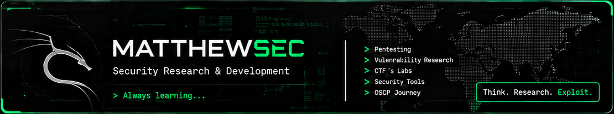

  

<h1 align="center">MatthewSec</h1>

  <b>Think. Research. Exploit.</b>

  Ethical Hacking | Web Application Security | Vulnerability Research

---

## About Me

Hello! I'm Matthew, an aspiring Penetration Tester
focused on Web Application Security and Ethical Hacking.

I'm passionate about understanding how applications
work, identifying security weaknesses and learning
how to improve their security.

I use this profile to document my technical journey,
security research, projects and practical learning.

## Certifications

- eJPTv2 — INE Security

## Technical Skills

| Category | Technologies |
|---|---|
| Operating Systems | Kali Linux, Linux |
| Security Tools | Burp Suite Professional, Nmap |
| Programming | Python (Fundamentals), Bash (Learning) |
| Databases | SQL |
| Web Security | OWASP Top 10, Web Pentesting |

## Areas of Interest

- Web Application Pentesting
- Vulnerability Research
- Bug Bounty Programs
- Reconnaissance & Enumeration
- Security Automation
- Offensive Security

## Current Focus

- Improving Web Application Security skills.
- Developing Python security tools.
- Practicing in authorized laboratories.
- Building my OSCP preparation roadmap.

## Projects

My technical projects and research will be documented here.

## Ethical Disclaimer

All security research and testing activities are
conducted in authorized environments and laboratories.

---

  <i>Learning. Researching. Building.</i>

